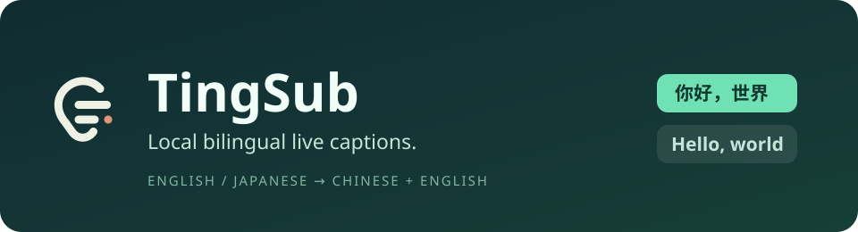
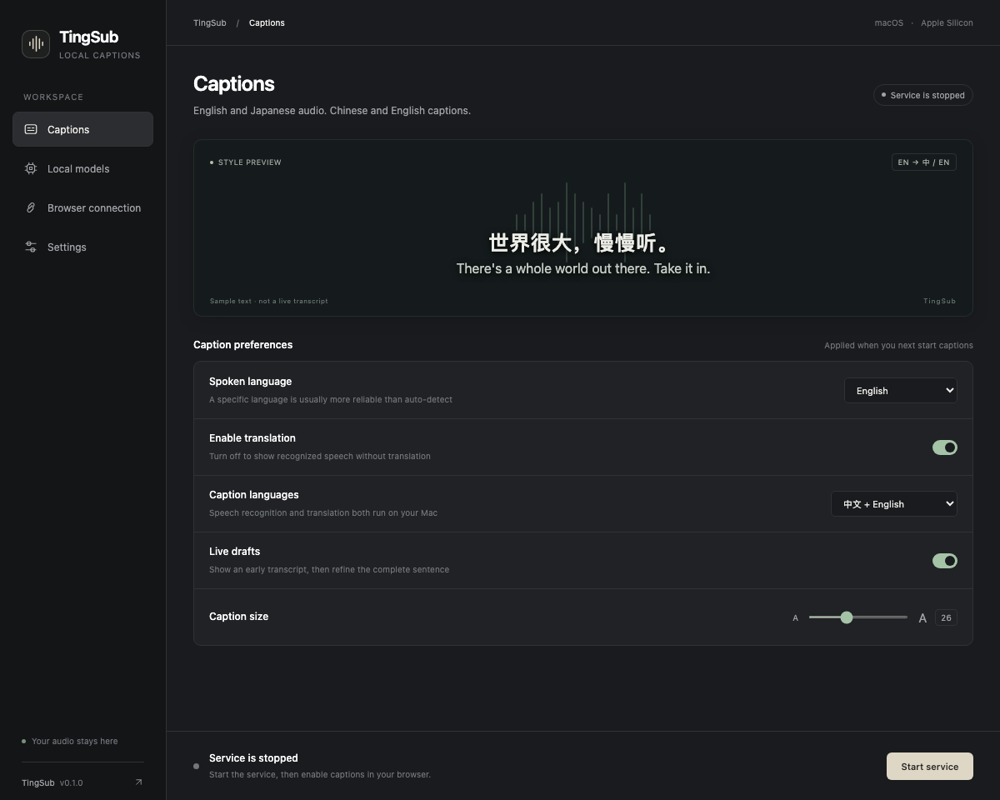
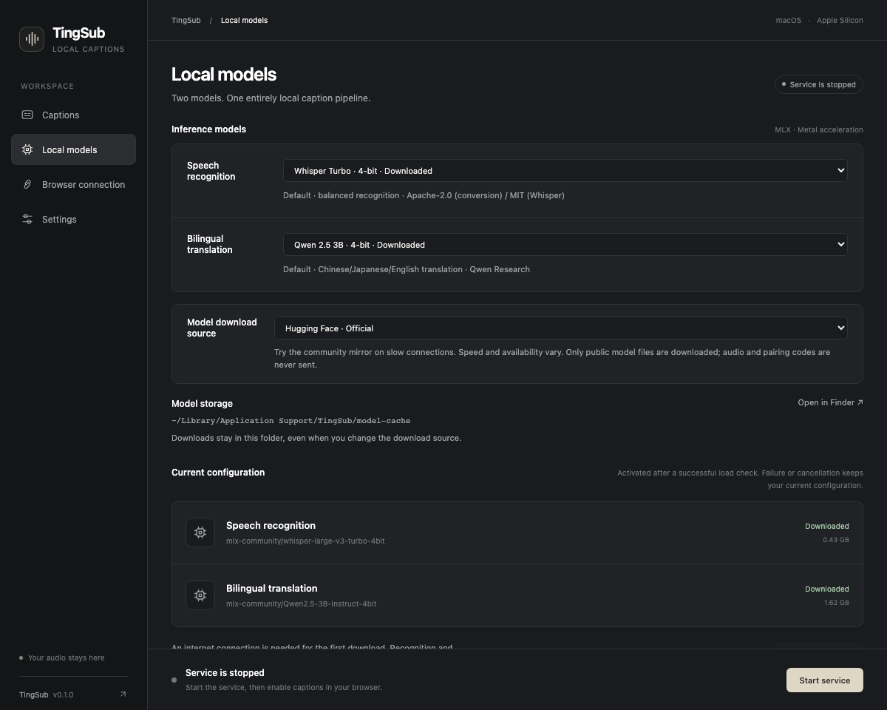
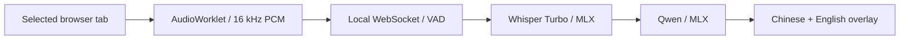

<p align="center"></p>

<p align="center">
  <a href="https://github.com/yeshan333/tingsub/actions/workflows/ci.yml"></a>
  <a href="LICENSE"></a>
  
  
</p>

<p align="center"><strong>English</strong> · <a href="README.zh-CN.md">简体中文</a></p>

# TingSub · 听桥

[Product homepage](https://shansan.top/tingsub/en/) · [Website maintenance](docs/en/website.md)

Generate **Chinese + English live captions** for English and Japanese browser videos, with speech recognition and translation running locally on your Apple Silicon Mac. Choose **Chinese + original** to keep Japanese speech in Japanese transcripts.

TingSub is an early-stage app that combines a local MLX service with a Chrome extension to capture selected video tabs, preserve audio playback, and overlay draggable captions across web pages (including YouTube fullscreen). It does not require existing player captions.

**Fully local inference after initial setup.** No cloud API keys, accounts, audio uploads, telemetry, or automatic recording. Internet access is only required during installation and initial model downloads; video playback continues using the browser's own network connection.

> **License scope:** TingSub code is MIT. The default Qwen2.5-3B translation weights use the **Qwen Research License**, with separate usage restrictions. They are not covered by MIT. Read [model licenses](docs/en/models.md) before using or distributing the models.

## What it does

- macOS menu bar: service status and controls, model/log shortcuts, and background operation after closing the window.
- English / Japanese input, including automatic language detection per segment.
- Optional recognition drafts, early Chinese output, then complete bilingual captions. Turn translation off to show recognized speech only.
- Desktop model selection, download progress, official/community/custom download sources, and Finder shortcuts for models and logs.
- Bounded queues and visible overload/rejection counts, so slow inference cannot silently accumulate an endless backlog.
- Per-segment first-text, first-Chinese and speech-end latency; a local pairing code protects the inference connection.
- One active tab at a time, without microphone access.

The desktop UI supports English and Simplified Chinese. The extension UI and most runtime messages remain Simplified Chinese. All user and contributor guides are available in **English and Simplified Chinese**. Interface languages do not change caption languages.

## Desktop window

Download the [macOS app](https://github.com/yeshan333/tingsub/releases/latest/download/TingSub-macos-arm64.dmg) · [Chrome extension](https://github.com/yeshan333/tingsub/releases/latest/download/TingSub-extension.zip) · [Release notes](https://github.com/yeshan333/tingsub/releases/latest). No GitHub login needed. Requires Apple Silicon; check the release notes for the minimum macOS version. The runtime is included. Current builds are not Apple-notarized. See [download and installation](docs/en/distribution.md#download-a-release).

The standalone App/DMG includes its runtime and browser extension: no Python or uv installation needed. First-time setup follows three steps:

1. **Install the app**: Download the DMG, drag `TingSub.app` to `/Applications`, and launch it.
2. **Download models and start the service**: In the Local models tab, choose a download source, download a model pair, and click **Start service**. Copy your pairing code from Browser connection.
3. **Pair the extension and start captions**: In Chrome (`chrome://extensions` Developer mode), load the unpacked extension, enter the pairing code, and play a video, and click **为当前标签页开启字幕** (start captions for this tab).

See the [desktop guide](docs/en/desktop.md) for full interface details. Maintainers building from source can follow the [distribution guide](docs/en/distribution.md).

### Product screenshots

**Caption workspace** — preview the caption style, choose languages, enable or disable translation, and control the local service.



**Local models** — browse speech and translation models, choose a download source, see the storage path, and open the model folder in Finder. You can browse while the service runs; stop it before applying a different pair.



These screenshots render the current desktop interface with example model availability and sample captions, not a live transcription or performance result. To refresh them from a development checkout: `node scripts/capture-desktop.mjs` (requires uv, npm dependencies and Playwright Chromium).

For development, run from source:

Source desktop development requires **Go 1.27.1+** and uv. The MyGo host embeds the UI and runs Python/MLX as a private child process. The standalone App requires neither Go nor Python.

```sh
uv run --frozen tingsub gui
```

You can also double-click `gui.command`. See the [desktop guide](docs/en/desktop.md) for first-time setup, the Dock launcher and shutdown behavior.

## Quick start from source

You need an **Apple Silicon Mac running macOS 14+**, **Chrome 116+**, and [uv](https://docs.astral.sh/uv/getting-started/installation/). 16 GB RAM is recommended; the two default model snapshots total roughly 2.2 GB, plus dependencies and caches. Intel Macs, Windows, Linux and Firefox are not supported inference targets in this version.

```sh
git clone https://github.com/yeshan333/tingsub.git
cd tingsub
uv sync --frozen --python 3.12
uv run --frozen tingsub prepare
uv run --frozen tingsub pair
uv run --frozen tingsub serve
```

Save the pairing code printed by `pair`. Wait for `Application startup complete` and keep the terminal open. On macOS you can also run `./setup.command`, then `./start.command`.

1. Open `chrome://extensions`, enable **Developer mode**, and choose **Load unpacked** → this repository's `extension/` directory.
2. Pin **TingSub · 听桥**. Open its popup → **本机配对** (Local pairing), then paste the pairing code.
3. Play a livestream. Select **英语** (English) or **日语** (Japanese), then click **为当前标签页开启字幕** (Start captions for this tab).
4. Use **停止** (Stop) or the caption panel's × button to stop. Navigating, refreshing or closing the captured tab stops the session too.

The service listens on `127.0.0.1:18765`. See the [installation guide](docs/en/installation.md) for updates, settings and uninstalling, or [troubleshooting](docs/en/troubleshooting.md) if it cannot connect. No Chrome Web Store listing or Apple-notarized release is available yet.

## How it works



Speech is submitted after a pause, or split at about 3 seconds during continuous speech. Drafts can appear earlier. A complete Chinese field can display before the English translation finishes. See [architecture and protocol](docs/en/architecture.md).

## Performance and limitations

Latency depends on speech length, draft mode, spoken language, GPU load, and machine hardware. End-of-speech latency is **not** the wait time from the start of an utterance. Long Japanese sentences, overlapping speakers, and background music can reduce accuracy; forced segment boundaries can split words. Rejected or overloaded segments remain visible in diagnostics but produce no translated caption.

The repository includes deterministic logic tests, isolated browser checks, and separate **real-model smoke tests**. Passing synthetic speech fixtures does not establish natural-livestream accuracy. A short test in signed-in Chrome confirmed continuous bilingual captions and drafts on the DW News YouTube livestream. The isolated YouTube browser test remains blocked by sign-in verification. Long-term stream stability and natural-speech accuracy remain unverified, and English-to-Chinese translation may add an unsupported AM/PM qualifier. One startup hang recovered only after reloading the extension, with the root cause undetermined. We do not advertise a universal latency figure or WER score. See [measurement methods and current limits](docs/en/benchmarks.md).

## Documentation

| Guide | English | 简体中文 |
| --- | --- | --- |
| Desktop GUI | [Read](docs/en/desktop.md) | [阅读](docs/zh-CN/desktop.md) |
| Documentation index | [Read](docs/en/README.md) | [阅读](docs/zh-CN/README.md) |
| Install, settings, update, uninstall | [Read](docs/en/installation.md) | [阅读](docs/zh-CN/installation.md) |
| Troubleshooting | [Read](docs/en/troubleshooting.md) | [阅读](docs/zh-CN/troubleshooting.md) |
| Architecture and protocol | [Read](docs/en/architecture.md) | [阅读](docs/zh-CN/architecture.md) |
| Development and testing | [Read](docs/en/development.md) | [阅读](docs/zh-CN/development.md) |
| Performance and validation | [Read](docs/en/benchmarks.md) | [阅读](docs/zh-CN/benchmarks.md) |
| Models and third-party licenses | [Read](docs/en/models.md) | [阅读](docs/zh-CN/models.md) |
| Privacy | [Read](docs/en/privacy.md) | [阅读](docs/zh-CN/privacy.md) |
| Contributing | [Read](CONTRIBUTING.md) | [阅读](CONTRIBUTING.zh-CN.md) |
| Security | [Read](SECURITY.md) | [阅读](SECURITY.zh-CN.md) |
| Changelog | [Read](CHANGELOG.md) | [阅读](CHANGELOG.zh-CN.md) |

## Contributing

Bug reports, documentation translations, and reproducible quality or performance improvements are welcome. Please read [CONTRIBUTING.md](CONTRIBUTING.md). Keep paired documentation pages in sync. Future work includes UI localization, natural-speech evaluation, better segmentation and additional backends; these are directions, not delivery commitments.

## License and acknowledgements

Code: [MIT](LICENSE). Models and dependencies retain their own licenses. Built with [MLX](https://github.com/ml-explore/mlx), [MLX Whisper](https://github.com/ml-explore/mlx-examples/tree/main/whisper), [MLX LM](https://github.com/ml-explore/mlx-lm), Whisper, Qwen, WebRTC VAD, FastAPI and Chrome extension APIs. See [model and dependency notices](docs/en/models.md).
